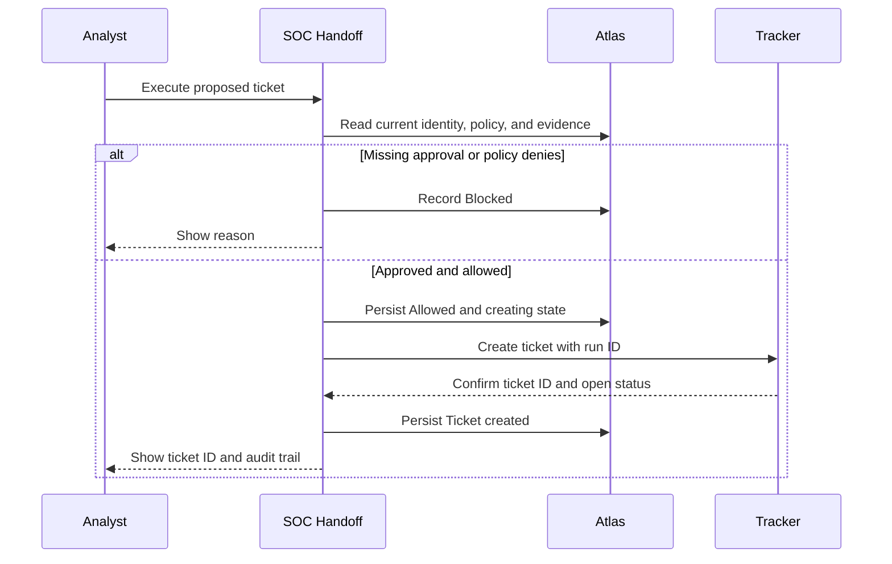

# SOC Handoff architecture

## Product goal

For Agents in Context Toronto Statement One, show that a SOC agent can propose one follow-up ticket, execute it under a named analyst's authority, and leave enough evidence for another analyst to reconstruct the decision. The demo starts from the synthetic MFA alert SOC-1042 and writes only to the sandbox tracker.

| Area | Owner | Responsibility |
| --- | --- | --- |
| App assembly | `soc_handoff/main.py`, `sandbox_tracker/main.py` | Wire routers, resource lifecycles, and error handlers. |
| Config | Each service's `config.py` | Read environment settings at startup. Exclude credentials from settings representations. |
| Authentication | Each service's `auth/` | Resolve the active Atlas analyst for the application. Check the bearer token for the tracker. |
| Middleware | `soc_handoff/middleware/` | Generate an HTTP request ID for responses and dependency-error logs. |
| HTTP routes | Each service's `routers/` and `schemas.py` | Define API contracts, validate input, and call the workflow or tracker store. |
| Workflow and policy | `soc_handoff/services/` | Evaluate approval and policy, move a run through its lifecycle, and record audit decisions. |
| App MongoDB | `soc_handoff/database/` | Manage the client and seed. Store identities, policy, findings, and audit runs. |
| Tracker HTTP adapter | `soc_handoff/integrations/tracker.py` | Send authenticated requests and validate ticket confirmations. |
| Tracker MongoDB | `sandbox_tracker/database/` | Persist tickets in the tracker database. Each run ID is a ticket document ID. |
| Browser | `soc_handoff/web/index.html` | Display the proposal, human controls, and audit trail. |

Each service owns its MongoDB client for its lifetime. SOC Handoff also owns an HTTP client for calling the tracker. Request handlers that access synchronous PyMongo or HTTPX use synchronous endpoints. Each service uses its own URI and database credentials. The tracker owns `soc_handoff_tracker.tickets`. SOC Handoff owns the identity, policy, findings and audit data in `soc_handoff`.

### Scope of the guide

The [AWS Builder Center guide](https://builder.aws.com/content/3KIyNGvHSTEbRk65U7jTytf9ab4/building-a-fastapi-backend-with-mongodb-a-practical-guide) informs the app entry point, environment-backed configuration, database layer, routers, Pydantic schemas, and health endpoint. The local demo uses HTTP Basic for analysts and a service token for tracker requests. A hosted version would need a separate authentication design. Both `/api/health` endpoints are liveness checks. MongoDB is checked at process startup.

## Action sequence

## Run state and failure handling

| State | Valid next action |
| --- | --- |
| `proposed` | Approve or stop. An early execute attempt records a policy denial. |
| `approved` | Execute or stop. Execution rechecks the policy version and verified evidence. |
| `creating` | Retry with the same run ID if the tracker outcome is uncertain. The tracker enforces one ticket per run. |
| `created` | Roll back by closing the associated ticket. |
| `closing` | Retry the close if the tracker outcome is uncertain. |
| `closed`, `canceled` | Terminal states. Audit history remains available. |

MongoDB updates a run and appends its audit event in a single revision-checked write. The two services write to separate MongoDB databases. A successful tracker write can arrive before SOC Handoff records the result in its own database. A retry uses the same run ID. Policy changes can block a retry. **Check tracker** can still show the external result for the run.

Atlas keeps the audit history inside each run document. The application appends events, and the deployment still relies on database permissions to protect those records. The browser login is HTTP Basic for the loopback demo. CI uses a disposable MongoDB instance with separate application and tracker databases.

## Acceptance checks

1. A signed-in analyst can open the dashboard and propose the seeded follow-up.
2. An unapproved run records **Blocked** and leaves the tracker without a ticket.
3. An approved run records **Allowed** before dispatch. The confirmed ticket ID appears in the tracker and in Atlas.
4. Repeating execution returns the same ticket. A tracker failure leaves the result unconfirmed.
5. Rollback closes the same ticket and preserves the earlier events.
6. The smoke test runs against real MongoDB and both HTTP services without Atlas secrets. It also checks the login challenge, the mutation guard, tracker authentication, and response request IDs.
